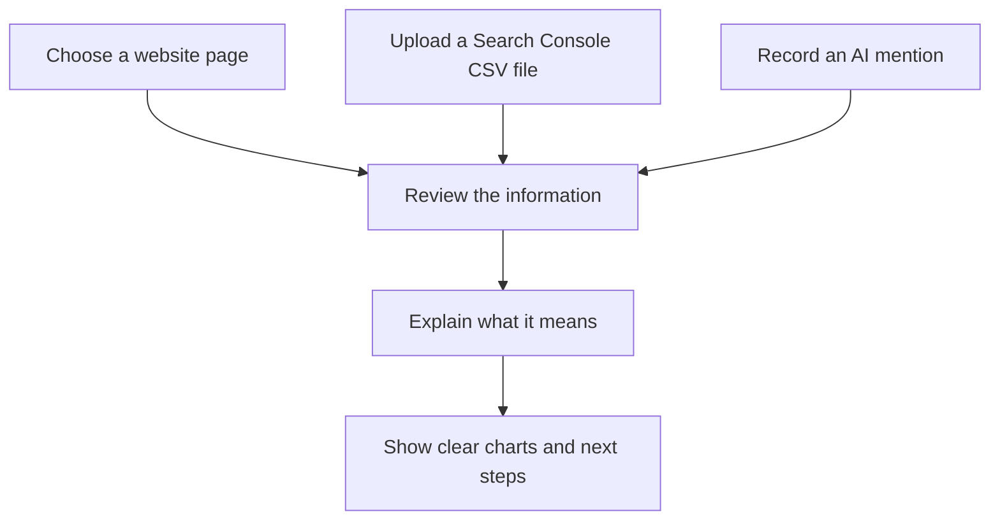

<p align="center"><strong>Understand how your website gets found.</strong></p>
<p align="center">Website audits · Search performance · AI search visibility</p>

> [!IMPORTANT]
> **In development.** SearchUnveil is a project we are building, not a finished product. No public version is available yet. The features below are planned; an early prototype of each lives in this repository for development and review.

## A clearer view of your website

**SearchUnveil** is an Atelance project that aims to make search data easier to understand.

Today, website information is often spread across different tools and reports. We want to bring useful findings into one clear view, so you can see **what happened, what it means, and what to check next**.

## What we plan to help with

| What you want to understand | What SearchUnveil aims to show |
| :--- | :--- |
| **Is my website easy to find?** | Common website and SEO issues, explained in plain language: type an address or paste a page, or review every page in a ZIP of your site. SearchUnveil Analyst, our own engine, turns each review into a ranked plan with title and description ideas, on your device, with no API key or account. |
| **How is my website doing in Google Search?** | Trends in clicks, impressions, pages, and queries from a Search Console CSV file you provide. |
| **Where has AI mentioned my website?** | A record of AI-generated mentions or citations that you add, with a source and date when known. |
| **What should I look at next?** | Simple charts, clear explanations, and suggested checks based on the information available. |

These areas are **development goals**. We do not claim to measure every AI response, predict rankings, or guarantee search traffic.

## How it is intended to work

**Start with one source of information.** You could choose a page to review, provide a Search Console CSV export, or record an AI mention. You would not need to provide all three.

The goal is straightforward: **add information → understand it → decide what to check next**.



**In plain words:** You choose information to review. SearchUnveil aims to organize it, explain the useful findings, and help you decide what to investigate.

*This diagram shows a proposed user experience. It is not an implemented or deployed system.*

### A simple example

Imagine you upload a Search Console CSV file. You might see:

> **Your pages appeared in search more often, but clicks stayed about the same.**
>
> See the trend, check the pages involved, and decide what to investigate.

*This is an example of the intended experience. The prototype's fictional sample data for example.com reproduces it; it is not an analysis of a real site.*

## Designed to be useful, not complicated

Our priorities are:

- **Clear language.** Short explanations that make sense on the first read.
- **Visible sources.** Make it easy to see where a finding came from.
- **Honest limits.** Explain what the data can and cannot tell you.
- **Thoughtful design.** Readable on mobile, accessible by keyboard, and easy to navigate.
- **Privacy and security.** Validate inputs, limit data collection, and protect private information.
- **Seven languages.** Work toward natural English, Spanish, German, French, Turkish, Simplified Chinese, and Arabic.

Read the [proposed technical approach](docs/TECHNICAL-DIRECTION.md) or the [design principles](docs/DESIGN-PRINCIPLES.md). Both describe goals, not finished features. To see how the early prototype works, read the [architecture](docs/ARCHITECTURE.md) and the [finding rules](docs/FINDINGS.md).

## Where the project stands

| Stage | Current status |
| :--- | :--- |
| Product concept and documentation | **In progress** |
| Website audit prototype | **Early prototype** in this repository |
| Search Console CSV analysis | **Early prototype** in this repository |
| AI mention log and clear reports | **Early prototype** in this repository |
| Accessibility, language, and security checks | **Automated checks in place**; manual and native-language reviews pending |
| Public release | Not announced |

This roadmap can change. We have not set a release date. The [architecture](docs/ARCHITECTURE.md#release-gates-where-the-prototype-stands) lists where the prototype stands against each release gate.

## Try the early prototype

The prototype runs on your own computer. Every review happens in your browser, and your files are never uploaded. Files of any size work: archives are read from their table of contents, and only what an analysis needs is read. You need [Node.js](https://nodejs.org/) 22.22 or later.

```sh
npm ci
npm run dev
```

Open the address it prints, then choose **Try sample data** on the Search Console page. The sample is fictional data for example.com. The [development guide](docs/DEVELOPMENT.md) covers tests and the production build.

To share the prototype as a single file, run `npm run build:standalone`. It writes `apps/web/dist-standalone/searchunveil.html`, which opens in any current browser without a server or a network connection.

To review pages by typing only their address, run the server version. It needs no API key:

```sh
npm run serve   # then open http://127.0.0.1:8787
```

The server downloads the page you name and its robots.txt, and keeps nothing; the review and SearchUnveil Analyst's plan run in your browser. To put it online, any host that runs a Dockerfile will do, or Docker on your own machine:

```sh
docker build -t searchunveil .
docker run -p 8080:8080 searchunveil   # then open http://localhost:8080
```

The [development guide](docs/DEVELOPMENT.md#put-it-online) lists the settings.

## Follow along

This repository is the public home for SearchUnveil's development.

**[Follow the repository](https://github.com/atelanceofficial/searchunveil-seo)** to watch progress, or **[share an idea](https://github.com/atelanceofficial/searchunveil-seo/issues/new)** through GitHub Issues.

Please do not include passwords, API keys, or private website information in a public issue.

## Availability and license

SearchUnveil has **no public release**. The code in this repository is an early prototype for development and review, not a product to rely on.

This repository does not currently include a software license. Public access does **not** mean the code is offered under an open source license. Usage and contribution terms will be clarified before a wider code release.

---

<p align="center"><strong>SearchUnveil</strong> · Built by Atelance</p>
<p align="center"><em>See how your website gets found.</em></p>
