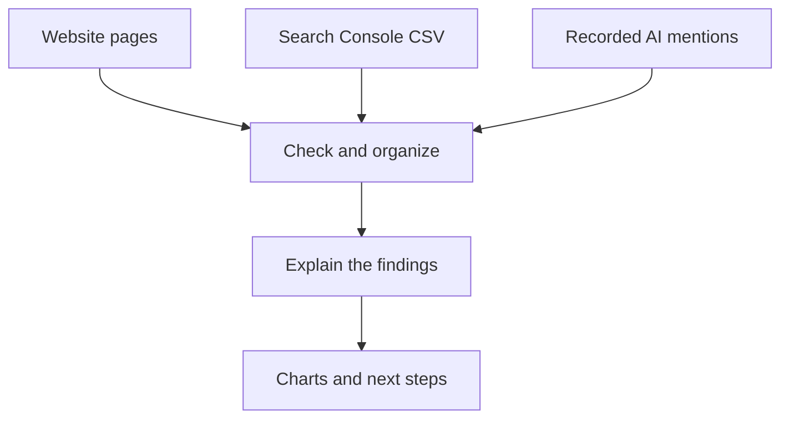

<strong>Make sense of your website's visibility.</strong>

SEO audits · Search analytics · AI search visibility

> [!IMPORTANT]
> **SearchUnveil is in development.** This page explains what we plan to build. There is no public release or working installation yet.

## One clear view of your website

SearchUnveil is a project by **Atelance**. We want to make it easier to understand how a website appears in search, what the numbers mean, and what to look at next.

Today, that information can be scattered across reports and tools. Our goal is to bring the important parts together and explain them in plain language.

## What we're building

| Area | What it will help you do |
| :--- | :--- |
| **Website audits** | Check common SEO issues and understand what needs attention. |
| **Search analytics** | Explore Google Search Console CSV data, including clicks, impressions, pages, and queries. |
| **AI visibility** | Keep a record of AI search mentions and citations, with sources and dates when available. |
| **Clear reports** | See useful charts and explanations instead of complicated dashboards. |
| **Seven languages** | Use the product in English, Spanish, German, French, Turkish, Simplified Chinese, and Arabic. |

These are **planned features**, not available tools. AI mentions are observations, not a complete measurement of AI search visibility. SearchUnveil will not guarantee traffic or rankings.

## How the information will flow

Our proposed design keeps three types of information separate, then presents them in one clear view.

*This is a product concept, not a diagram of a deployed system.*

## Built with care

We want the product to feel simple without cutting corners in its engineering.

- **Clear evidence.** Show where insights come from and explain their limits.
- **Secure by design.** Plan for safe file imports, input validation, and careful handling of private data.
- **Fast and accessible.** Design for mobile screens, keyboard navigation, and readable contrast.
- **Reliable changes.** Introduce automated tests and code checks as development progresses.
- **Natural language.** Write short explanations and review translations for clarity.

## Development roadmap

| Stage | Status | Focus |
| :--- | :--- | :--- |
| Product planning | **In progress** | Shape the first release and user journeys. |
| Core prototype | Planned | Website checks and Search Console CSV exploration. |
| Insight experience | Planned | AI mention log, interactive charts, and clear explanations. |
| Quality and access | Planned | Accessibility, translations, security testing, and documentation. |
| Public release | Not announced | Publish a usable version when it is ready. |

The roadmap may change as we learn. We have not announced a release date.

## Follow the progress

We are documenting development here on GitHub.

**[Watch the repository](https://github.com/atelanceofficial/searchunveil-seo)** to follow updates, or **[share feedback in an issue](https://github.com/atelanceofficial/searchunveil-seo/issues/new)** if there is a problem you would like SearchUnveil to solve.

Please do not share passwords, API keys, or private website data in a public issue.

## Availability and licensing

SearchUnveil is **not available to install or use yet**. There is no public demo or stable release in this repository.

This repository currently has **no software license**. Being public on GitHub does not grant an open source license. We will clarify code usage and contribution terms before any wider release.

---

<strong>SearchUnveil</strong> · An Atelance project

<em>See how your website gets found.</em>

