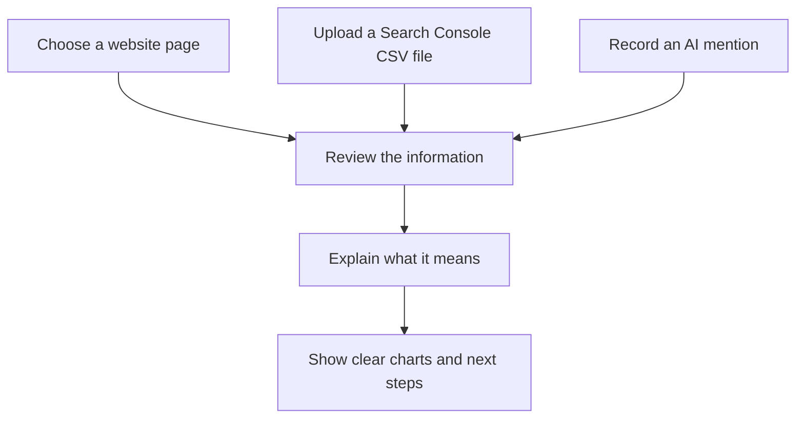

<strong>Understand how your website gets found.</strong>

Website audits · Search performance · AI search visibility

> [!IMPORTANT]
> **In development.** SearchUnveil is a project we are building, not a finished product. No public version is available yet. All features below are planned.

## A clearer view of your website

**SearchUnveil** is an Atelance project that aims to make search data easier to understand.

Today, website information is often spread across different tools and reports. We want to bring useful findings into one clear view, so you can see **what happened, what it means, and what to check next**.

## What we plan to help with

| What you want to understand | What SearchUnveil aims to show |
| :--- | :--- |
| **Is my website easy to find?** | Common website and SEO issues, explained in plain language. |
| **How is my website doing in Google Search?** | Trends in clicks, impressions, pages, and queries from a Search Console CSV file you provide. |
| **Where has AI mentioned my website?** | A record of AI-generated mentions or citations that you add, with a source and date when known. |
| **What should I look at next?** | Simple charts, clear explanations, and suggested checks based on the information available. |

These areas are **development goals**. We do not claim to measure every AI response, predict rankings, or guarantee search traffic.

## How it is intended to work

**Start with one source of information.** You could choose a page to review, provide a Search Console CSV export, or record an AI mention. You would not need to provide all three.

The goal is straightforward: **add information → understand it → decide what to check next**.

**In plain words:** You choose information to review. SearchUnveil aims to organize it, explain the useful findings, and help you decide what to investigate.

*This diagram shows a proposed user experience. It is not an implemented or deployed system.*

### A simple example

Imagine you upload a Search Console CSV file. You might see:

> **Your pages appeared in search more often, but clicks stayed about the same.**
>
> See the trend, check the pages involved, and decide what to investigate.

*This is an example of the intended experience, not a screenshot or real analysis from the product.*

## Designed to be useful, not complicated

Our priorities are:

- **Clear language.** Short explanations that make sense on the first read.
- **Visible sources.** Make it easy to see where a finding came from.
- **Honest limits.** Explain what the data can and cannot tell you.
- **Thoughtful design.** Readable on mobile, accessible by keyboard, and easy to navigate.
- **Privacy and security.** Validate inputs, limit data collection, and protect private information.
- **Seven languages.** Work toward natural English, Spanish, German, French, Turkish, Simplified Chinese, and Arabic.

Read the [proposed technical approach](docs/TECHNICAL-DIRECTION.md) or the [design principles](docs/DESIGN-PRINCIPLES.md). Both describe goals, not finished features.

## Where the project stands

| Stage | Current status |
| :--- | :--- |
| Product concept and documentation | **In progress** |
| Website audit prototype | Planned |
| Search Console CSV analysis | Planned |
| AI mention log and clear reports | Planned |
| Accessibility, language, and security checks | Planned |
| Public release | Not announced |

This roadmap can change. We have not set a release date.

## Follow along

This repository is the public home for SearchUnveil's development.

**[Follow the repository](https://github.com/atelanceofficial/searchunveil-seo)** to watch progress, or **[share an idea](https://github.com/atelanceofficial/searchunveil-seo/issues/new)** through GitHub Issues.

Please do not include passwords, API keys, or private website information in a public issue.

## Availability and license

SearchUnveil is **not available to use or install yet**. There is no stable public release.

This repository does not currently include a software license. Public access does **not** mean the code is offered under an open source license. Usage and contribution terms will be clarified before a wider code release.

---

<strong>SearchUnveil</strong> · Built by Atelance

<em>See how your website gets found.</em>

