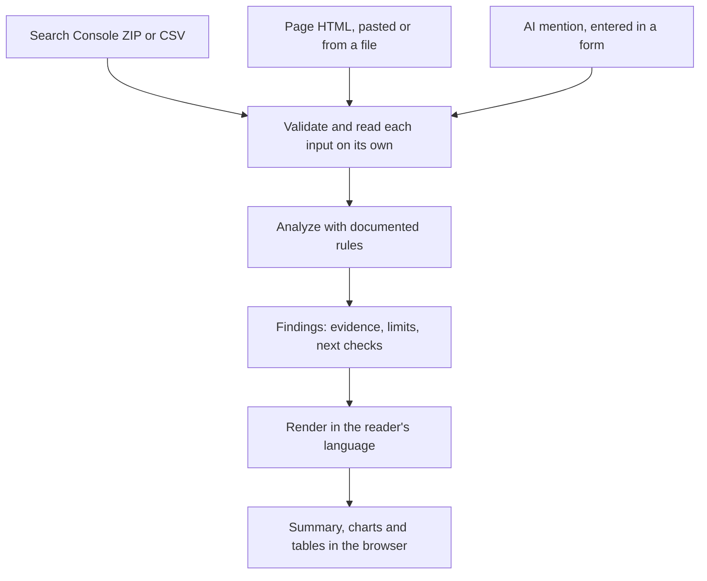

# Architecture

> **Early prototype · Not a public release**
>
> This document describes the code that exists in this repository today. It is a working prototype for exploring the ideas in the [technical direction](TECHNICAL-DIRECTION.md), not a finished or audited product.

## In one paragraph

SearchUnveil is a static web app backed by a small analysis engine. Everything runs on the person's own device: the files they choose are read in memory, analyzed, and explained in their language. Nothing is uploaded, and the production build's security policy blocks every network connection after the page loads. Each result is a **finding** that carries its evidence, its limitations and what to check next.

## How the pieces fit

## Repository layout

| Path | What it holds |
| :--- | :--- |
| `packages/core` | `@searchunveil/core`, the engine. TypeScript with no runtime dependencies; runs in browsers and in Node.js. |
| `apps/web` | The static Preact app: views, components, interface translations and browser tests. |
| `scripts` | Repository checks: invisible-character scan and reference link check. |
| `docs` | Product direction, design principles, this architecture, [finding rules](FINDINGS.md), [decision records](adr/README.md) and the [development guide](DEVELOPMENT.md). |

## The engine (`packages/core`)

| Module | Responsibility | Guarantees |
| :--- | :--- | :--- |
| `zip` | Reads the ZIP archive Search Console downloads. | Rejects encrypted, split and ZIP64 archives; enforces entry, size and compression-ratio limits before inflating; detects overlapping entries; stops at the declared size; verifies every CRC-32. |
| `text` | Decodes files and folds text for matching. | Honors byte order marks, detects UTF-16, refuses binary files, and reports when it had to assume a legacy encoding chosen from the reader's language. |
| `csv` | Reads and writes CSV. | RFC 4180 with real-world tolerance (semicolons, tabs, `sep=` hints, CR/LF/CRLF); malformed quoting is reported with line numbers; explicit row, column and field limits; formula-safe export. |
| `gsc` | Understands Search Console exports and analyzes them. | Recognizes tables by header or by Search Console's fixed column order; parses numbers and dates written in any of the seven languages; checks integrity (clicks never exceed impressions, CTR matches clicks ÷ impressions); keeps comparison-period labels verbatim. |
| `analysis` | Period comparison and statistics. | Whole-week periods aligned by weekday; incomplete final days left out; CTR recomputed from sums; position weighted by impressions; an exact sign test describes day-by-day consistency. |
| `audit` | Reviews one page's HTML. | Works on any standard DOM; detects tags pushed out of `<head>`; never claims to know about JavaScript, HTTP headers or robots.txt. |
| `mentions` | The AI mention log. | Validates every field; imports and exports a versioned JSON format; summarizes counts only, with no visibility score. |
| `i18n` | Messages and formatting. | ICU MessageFormat subset with plural and select; locale-aware numbers and UTC-safe dates; bidirectional isolation of people's own text. |

### Findings

Every finding has a stable `rule` identifier documented in [FINDINGS.md](FINDINGS.md), a `status`, a `title` and optionally a `summary`, plus lists of `evidence`, `limitations`, `nextChecks` and `references`. Some findings also carry a table, such as the queries an opportunity applies to.

| Status | Meaning |
| :--- | :--- |
| Needs attention | Likely to hurt how the site is found; act on it first. |
| Worth a look | Worth a closer look; often an opportunity. |
| Looks good | A healthy result or a positive change. |
| Good to know | Context that helps read the other findings. |

The engine never formats prose. Titles and evidence are **message keys with typed parameters** (numbers, percentages, dates, date ranges, quoted markup), so every interface can render them in the reader's language. See [ADR 0003](adr/0003-explainable-findings-as-messages.md).

## Languages

Seven languages ship together: English, Spanish, German, French, Turkish, Simplified Chinese and Arabic (right to left).

- English is the source catalog. TypeScript rejects any catalog that misses or adds a key.
- Tests check that every translation uses exactly the source's placeholders and select options, that every plural branch renders, and that real findings render without gaps in every language.
- Numbers, percentages and dates are formatted with `Intl` for each locale. Dates are formatted in UTC so a calendar day never shifts with the viewer's time zone.
- Text quoted from a person's data is isolated (`<bdi>`, or Unicode isolates in plain strings) so an English query stays readable inside an Arabic sentence.
- Translations are drafts. Native review is a release gate.

## Security and privacy model

| Concern | Control in the prototype |
| :--- | :--- |
| Data leaving the device | No server. The production Content Security Policy sets `connect-src 'none'`; a browser test proves a `fetch` is refused. |
| Malicious archives | Limits on entries, sizes and ratios; overlap detection; streaming inflation that stops at the declared size; CRC-32 verification. |
| Oversized or malformed files | Explicit limits for file size, rows, columns and field length, reported instead of silently truncated. |
| Pasted HTML | Parsed with `DOMParser` into an inert document (no scripts, no resource loading; verified in a browser test) through the only Trusted Types policy the page allows. |
| Cross-site scripting | No `innerHTML`; Preact escapes text; Trusted Types are required for any HTML sink. |
| Spreadsheet formula injection | Exported CSV neutralizes cells that begin with `=`, `+`, `-`, `@` and their full-width forms. |
| Stored data | Only the AI mention log and two preferences, in this browser's storage, with a "delete everything" control. |
| Supply chain | Exact versions, a lockfile, a 14-day release cooldown, no dependency install scripts, CI actions pinned to commit SHAs. See [ADR 0004](adr/0004-dependency-and-supply-chain-policy.md). |
| Hidden characters in source | A repository check rejects invisible and bidirectional control characters ("Trojan Source"). |

These controls are implemented and tested, but **not independently reviewed**.

## Accessibility

The interface targets WCAG 2.2 AA:

- Landmarks, one `h1` per view, focus moved to the new heading after navigation, a skip link, and a polite live region for status changes.
- Status is always shown with an icon and words, never by color alone.
- Color tokens are tested for contrast in both themes (text at least 4.5:1, interface parts at least 3:1).
- Charts include a text description and a table of the same numbers.
- Logical CSS properties mirror the layout for Arabic; `forced-colors` and `prefers-reduced-motion` are respected; touch targets are at least 44 pixels.
- Browser tests run axe-core against every main view in light, dark and right-to-left layouts, check keyboard flows, and check that nothing scrolls sideways at 320 CSS pixels.

Automated checks find many problems but not all of them. Manual screen reader testing has not been done yet.

## Testing strategy

| Layer | What it covers |
| :--- | :--- |
| Unit tests (Vitest) | Parsers, limits, statistics, every rule, message formatting. |
| Property-based tests (fast-check) | CSV round trips; numbers, percentages and decimals formatted by `Intl` in every supported locale are read back exactly. |
| Scenario tests | Realistic exports end to end, including the story in the README. |
| Catalog integrity | Keys, placeholders, plural branches and rendered findings in all seven languages. |
| Design tokens | WCAG contrast of every token pair in both themes, read from the stylesheet. |
| Browser tests (Playwright) | Production build with its real security policy: flows, keyboard, focus, axe-core, reflow, blocked network requests. |

Coverage thresholds are enforced in CI (lines, statements and functions at least 90%, branches at least 85%).

## Release gates: where the prototype stands

The [technical direction](TECHNICAL-DIRECTION.md#release-gates) lists what must be shown before any feature is described as available. Honest status:

| Gate | Status |
| :--- | :--- |
| Reproducible local setup and documented build | In place for the prototype: lockfile, pinned tools, [development guide](DEVELOPMENT.md), CI. |
| Tests for valid and malformed inputs | In place: hundreds of tests, including malformed CSV, ZIP, HTML and JSON. |
| Clear error states and source attribution | In place in the prototype; not yet tested with people. |
| Security review of file handling and network access | Defenses implemented and tested; independent review not done. |
| Keyboard, screen reader, mobile and contrast checks | Automated checks in place; manual screen reader testing not done. |
| Translation review, including Arabic right to left | Draft translations; native review not done. |
| Accurate privacy information and data deletion | Implemented in the prototype; not reviewed. |
| A working demo and installation instructions | Local demo with fictional sample data; no hosted demo. |

## What the prototype does not do

- It does not connect to Google Search Console; it reads exports the person chooses.
- It does not fetch web pages; people paste HTML or choose a saved file. Fetching would need a server with the protections described in the technical direction.
- It does not monitor AI assistants; it records what people observed.
- It has no accounts, sync or sharing.

---

**SearchUnveil · An Atelance project**  
Return to the [project overview](../README.md).
