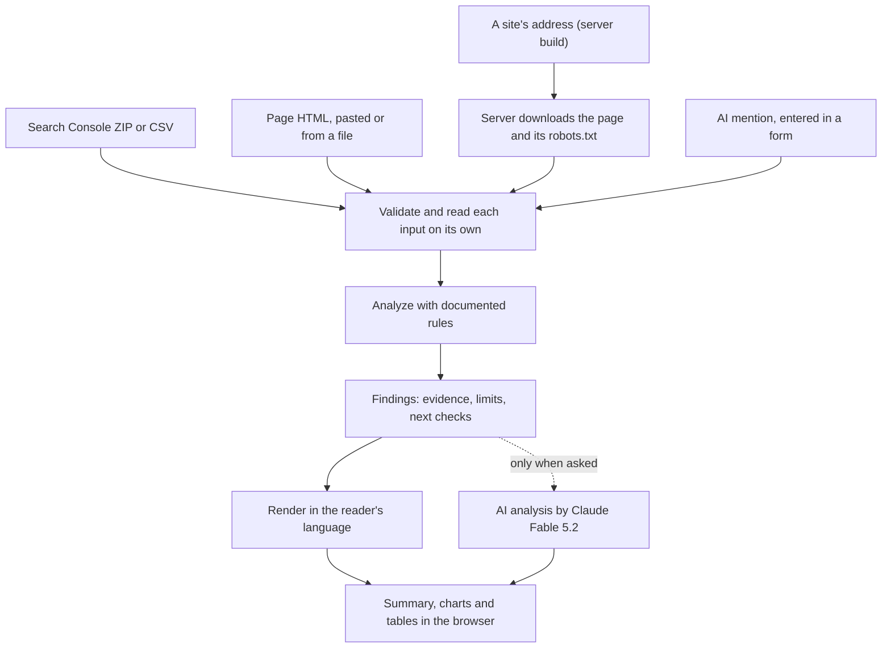

# Architecture

> **Early prototype · Not a public release**
>
> This document describes the code that exists in this repository today. It is a working prototype for exploring the ideas in the [technical direction](TECHNICAL-DIRECTION.md), not a finished or audited product.

## In one paragraph

SearchUnveil is a web app backed by a small analysis engine and its own analyst, which turns each page review into a ranked plan on the device ([ADR 0006](adr/0006-built-in-analyst.md)). The checks run on the person's own device: the files they choose are read in memory, analyzed, and explained in their language. The static build uploads nothing, and its security policy blocks every network connection after the page loads. An optional server build adds the one thing a browser cannot do alone: downloading a page by its address ([ADR 0005](adr/0005-optional-server-for-addresses-and-ai.md)). Nothing needs an API key ([ADR 0007](adr/0007-no-api-keys.md)); opened inside Claude, the app can also ask Claude Fable 5.2 for a second opinion on the viewer's own account. Each result is a **finding** that carries its evidence, its limitations and what to check next.

## How the pieces fit

## Repository layout

| Path | What it holds |
| :--- | :--- |
| `packages/core` | `@searchunveil/core`, the engine. TypeScript with no runtime dependencies; runs in browsers and in Node.js. |
| `apps/web` | The static Preact app: views, components, interface translations and browser tests. |
| `apps/server` | The optional server: serves the app and downloads pages by address. No API key, no dependencies beyond the engine. |
| `scripts` | Repository checks: invisible-character scan and reference link check. |
| `docs` | Product direction, design principles, this architecture, [finding rules](FINDINGS.md), [decision records](adr/README.md) and the [development guide](DEVELOPMENT.md). |

## The engine (`packages/core`)

| Module | Responsibility | Guarantees |
| :--- | :--- | :--- |
| `source` | Gives every file random access, read in parts. | A browser `File` is never loaded whole: size alone never turns a file away. |
| `zip` | Reads ZIP archives of any size: the one Search Console downloads, or a site's backup. | Reads only the end record, the directory and the entries asked for, ZIP64 included; rejects encrypted and split archives; checks entry counts, overlapping entries and compression ratios before inflating; stops at the declared size; verifies every CRC-32 while streaming. |
| `text` | Decodes files and folds text for matching. | Honors byte order marks, detects UTF-16, refuses binary files, and reports when it had to assume a legacy encoding chosen from the reader's language. |
| `csv` | Reads and writes CSV. | Parses text as it streams in, with exact record boundaries across pieces; RFC 4180 with real-world tolerance (semicolons, tabs, `sep=` hints, CR/LF/CRLF); malformed quoting is reported with line numbers; explicit row, column and field limits; formula-safe export. |
| `gsc` | Understands Search Console exports and analyzes them. | Recognizes tables by header or by Search Console's fixed column order; parses numbers and dates written in any of the seven languages; checks integrity (clicks never exceed impressions, CTR matches clicks ÷ impressions); keeps comparison-period labels verbatim. |
| `analysis` | Period comparison and statistics. | Whole-week periods aligned by weekday; incomplete final days left out; CTR recomputed from sums; position weighted by impressions; an exact sign test describes day-by-day consistency. |
| `audit` | Reviews one page's HTML, or every page of a site from a ZIP or several HTML files; describes what search engines see; reviews a server's answer and reads robots.txt. | Works on any standard DOM; detects tags pushed out of `<head>`; never claims to know about JavaScript, and covers HTTP headers and robots.txt only when the server fetched the page. robots.txt follows RFC 9309 as Googlebot applies it. A site review decompresses one page at a time, hands control back to the browser between pages, can be stopped, and shows how many pages each issue affects. |
| `analyst` | SearchUnveil Analyst: turns a review into a ranked plan with ideas, on the device. | Rules and text statistics only: no model, no network, the same output for the same input. Language detection for twelve languages, word and sentence division by `Intl.Segmenter`, ideas built only from the page's own words, every message translated. |
| `ai` | Builds the request for Claude's second opinion, inside Claude, and reads the answer. | Never calls a model itself. Sends evidence only (findings, facts, the start of the visible text), marked as data rather than instructions; an invalid page language never reaches the instructions; answers are untrusted: unknown fields are dropped, lengths and counts are capped, and anything without a summary or a usable priority is refused. |
| `mentions` | The AI mention log. | Validates every field; imports and exports a versioned JSON format; summarizes counts only, with no visibility score. |
| `i18n` | Messages and formatting. | ICU MessageFormat subset with plural and select; locale-aware numbers and UTC-safe dates; bidirectional isolation of people's own text. |

### The optional server (`apps/server`)

| Endpoint | What it does | Guarantees |
| :--- | :--- | :--- |
| `GET /api/health` | Says that pages can be fetched. | Reveals no settings. |
| `POST /api/page` | Downloads one page by its address, with its robots.txt. | Public addresses only, checked for every DNS answer and pinned for the connection; standard ports; at most five redirects, each checked; 15-second deadline; 15 MB after decompression; HTML only; nothing stored. |

The server uses Node.js's built-in HTTP modules and the engine; it has no other dependency and needs no API key.

### Findings

Every finding has a stable `rule` identifier documented in [FINDINGS.md](FINDINGS.md), a `status`, a `title` and optionally a `summary`, plus lists of `evidence`, `limitations`, `nextChecks` and `references`. Some findings also carry a table, such as the queries an opportunity applies to.

| Status | Meaning |
| :--- | :--- |
| Needs attention | Likely to hurt how the site is found; act on it first. |
| Worth a look | Worth a closer look; often an opportunity. |
| Looks good | A healthy result or a positive change. |
| Good to know | Context that helps read the other findings. |

The engine never formats prose. Titles and evidence are **message keys with typed parameters** (numbers, percentages, dates, date ranges, quoted markup), so every interface can render them in the reader's language. See [ADR 0003](adr/0003-explainable-findings-as-messages.md).

## Languages

Seven languages ship together: English, Spanish, German, French, Turkish, Simplified Chinese and Arabic (right to left).

- English is the source catalog. TypeScript rejects any catalog that misses or adds a key.
- Tests check that every translation uses exactly the source's placeholders and select options, that every plural branch renders, and that real findings render without gaps in every language.
- Numbers, percentages and dates are formatted with `Intl` for each locale. Dates are formatted in UTC so a calendar day never shifts with the viewer's time zone.
- Text quoted from a person's data is isolated (`<bdi>`, or Unicode isolates in plain strings) so an English query stays readable inside an Arabic sentence.
- Translations are drafts. Native review is a release gate.

## Security and privacy model

| Concern | Control in the prototype |
| :--- | :--- |
| Data leaving the device | The static and standalone builds have no server: their Content Security Policy sets `connect-src 'none'`, and a browser test proves a `fetch` is refused. The server build allows `connect-src 'self'` only, also checked by a browser test. The interface's privacy statements change with the build. |
| Server-side request forgery | Only `http`/`https` on standard ports; every resolved address must be public (loopback, private, link-local and cloud metadata, carrier-grade NAT, documentation, benchmarking, multicast and reserved ranges refused, also inside IPv6); the checked address is pinned for the connection; redirects re-checked; deadline and size limits; tests run against local servers and fake DNS answers. |
| Use of the API by other sites | JSON requests only, and the `Origin` must be the app's own; no cross-origin headers are sent. |
| Abuse | At most 20 page fetches a minute per visitor. |
| API keys | None, in any build ([ADR 0007](adr/0007-no-api-keys.md)). |
| What the AI second opinion receives | Only inside Claude, only on request, after the panel says what is sent: findings, page facts and the start of the visible text, through the viewer's own account and consent dialog. Files, the mention log and the rest of the page are never sent. |
| Model output | Treated as untrusted input: parsed against a fixed shape, capped in length, and rendered as text, never as HTML. |
| Malicious archives | Limits on entries, directory size and compression ratio; overlap detection; streaming inflation that stops at the declared size; CRC-32 verification. |
| Large or malformed files | Size alone is never refused: archives are read from their directory and text streams through the parsers, so memory holds only what an analysis keeps. Explicit limits for rows, columns, field length and pages held whole are reported instead of silently truncated. |
| Pasted HTML | Parsed with `DOMParser` into an inert document (no scripts, no resource loading; verified in a browser test) through the only Trusted Types policy the page allows. |
| Cross-site scripting | No `innerHTML`; Preact escapes text; Trusted Types are required for any HTML sink. |
| Spreadsheet formula injection | Exported CSV neutralizes cells that begin with `=`, `+`, `-`, `@` and their full-width forms. |
| Stored data | Only the AI mention log and two preferences, in this browser's storage, with a "delete everything" control. |
| Single-file build | The standalone file carries the same policy: its inline script and styles are allowed only by their SHA-256 hashes, and `connect-src 'none'` still applies. A browser test opens it from disk. |
| Supply chain | Exact versions, a lockfile, a 14-day release cooldown, no dependency install scripts, CI actions pinned to commit SHAs. See [ADR 0004](adr/0004-dependency-and-supply-chain-policy.md). |
| Hidden characters in source | A repository check rejects invisible and bidirectional control characters ("Trojan Source"). |

These controls are implemented and tested, but **not independently reviewed**.

## Accessibility

The interface targets WCAG 2.2 AA:

- Landmarks, one `h1` per view, focus moved to the new heading after navigation, a skip link, and a polite live region for status changes.
- Status is always shown with an icon and words, never by color alone.
- Color tokens are tested for contrast in both themes (text at least 4.5:1, interface parts at least 3:1).
- Charts include a text description and a table of the same numbers.
- Logical CSS properties mirror the layout for Arabic; `forced-colors`, `prefers-contrast` and `prefers-reduced-motion` are respected; touch targets are at least 44 pixels.
- Decorative patterns sit behind content, never carry meaning, and are hidden from assistive technology; see the [visual language](DESIGN-PRINCIPLES.md#how-the-prototype-uses-it).
- Browser tests run axe-core against every main view in light, dark and right-to-left layouts, check keyboard flows, and check that nothing scrolls sideways at 320 CSS pixels.

Automated checks find many problems but not all of them. Manual screen reader testing has not been done yet.

## Testing strategy

| Layer | What it covers |
| :--- | :--- |
| Unit tests (Vitest) | Parsers, limits, statistics, every rule, message formatting. |
| Property-based tests (fast-check) | CSV round trips; numbers, percentages and decimals formatted by `Intl` in every supported locale are read back exactly. |
| Scenario tests | Realistic exports end to end, including the story in the README. |
| Catalog integrity | Keys, placeholders, plural branches and rendered findings in all seven languages. |
| Design tokens | WCAG contrast of every token pair in both themes, read from the stylesheet. |
| Browser tests (Playwright) | Production build with its real security policy: flows, keyboard, focus, axe-core, reflow, blocked network requests. |
| Server tests | Address checks for every reserved range, fetching through local servers (redirects, compression, encodings, robots.txt, limits, timeouts), request validation, origin and rate limits. |

Coverage thresholds are enforced in CI (lines, statements and functions at least 90%, branches at least 85%).

## Release gates: where the prototype stands

The [technical direction](TECHNICAL-DIRECTION.md#release-gates) lists what must be shown before any feature is described as available. Honest status:

| Gate | Status |
| :--- | :--- |
| Reproducible local setup and documented build | In place for the prototype: lockfile, pinned tools, [development guide](DEVELOPMENT.md), CI. |
| Tests for valid and malformed inputs | In place: hundreds of tests, including malformed CSV, ZIP, HTML and JSON. |
| Clear error states and source attribution | In place in the prototype; not yet tested with people. |
| Security review of file handling and network access | Defenses implemented and tested; independent review not done. |
| Keyboard, screen reader, mobile and contrast checks | Automated checks in place; manual screen reader testing not done. |
| Translation review, including Arabic right to left | Draft translations; native review not done. |
| Accurate privacy information and data deletion | Implemented in the prototype; not reviewed. |
| A working demo and installation instructions | Local demo with fictional sample data; no hosted demo. |

## What the prototype does not do

- It does not connect to Google Search Console; it reads exports the person chooses.
- The static app does not fetch web pages; people paste HTML or choose a saved file. The optional server build fetches one page at a time by its address; it does not crawl a site.
- Claude's second opinion needs the app opened inside Claude; it reads one review at a time and is never run without being asked. SearchUnveil Analyst's plan needs nothing.
- It does not monitor AI assistants; it records what people observed.
- It has no accounts, sync or sharing.

---

**SearchUnveil · An Atelance project**  
Return to the [project overview](../README.md).
