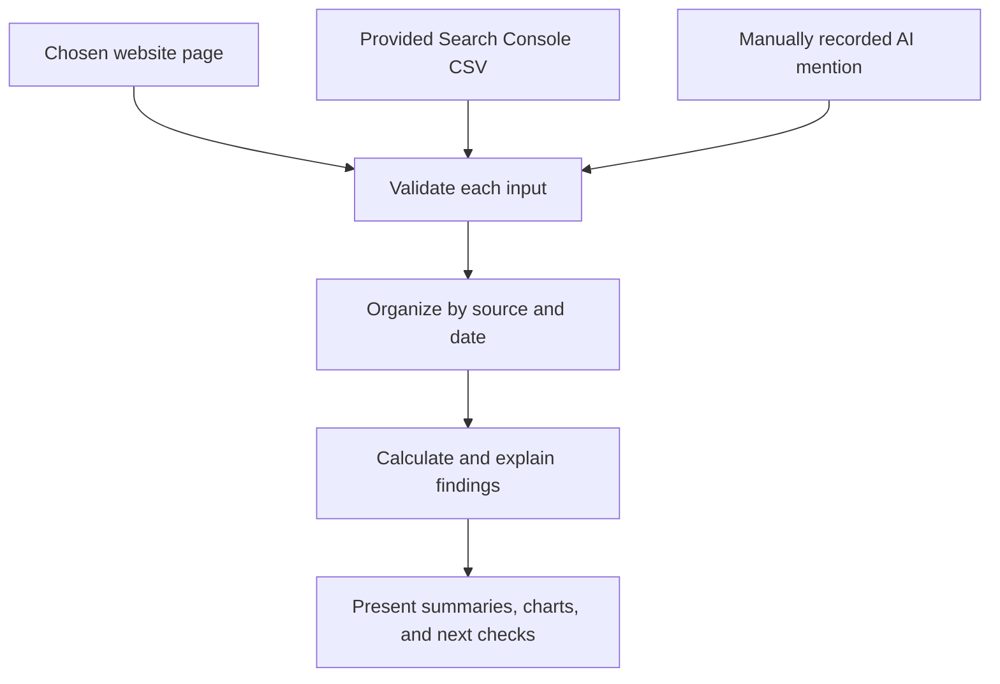

# Technical direction

> **Planning document · Not an implemented architecture**
>
> This document describes the engineering approach we are considering for SearchUnveil. It is **not** a list of working features, selected vendors, or deployed infrastructure. Technical choices may change after prototyping and testing.

## What we want to build

We aim to turn three different kinds of information into useful, understandable findings:

1. **Website information:** Pages a user chooses to review for common technical and content issues.
2. **Search Console CSV files:** Search performance data the user explicitly exports and provides.
3. **Recorded AI mentions:** Observations the user adds, including a source and timestamp when known.

Each kind of input must be understandable on its own. Combining them must never imply that separate metrics measure the same thing.

## Proposed flow

This is a **direction**, not a deployed system.

## Engineering decisions to evaluate

| Area | Proposed approach | Why it matters |
| :--- | :--- | :--- |
| **Data contracts** | Define typed input and output schemas; version schema changes. | Prevent ambiguous results and accidental data mixing. |
| **CSV processing** | Validate file type, headers, encoding, row size, and field formats; process large inputs with explicit limits. | Keep imports predictable and safe. |
| **Website review** | Limit outbound fetch targets, reject private network destinations, and set request timeouts. | Reduce server-side request forgery risks if fetching is server-side. |
| **AI mention records** | Record observed text, source URL, capture date, and method when supplied. | Make claims auditable rather than treating observations as total coverage. |
| **Analysis** | Prefer explainable calculations and traceable rules; show missing data and uncertainty. | Avoid opaque or overstated insights. |
| **Security** | Threat-model each input path; review authentication, access control, rate limits, and dependencies before launch. | Protect users and the service. |
| **Privacy** | Prefer minimal collection, clear consent, restricted access, defined retention, and deletion controls. | Protect potentially sensitive search data. |
| **Internationalization** | Localize content and UI with reviewable translation keys; handle right-to-left layouts and local number formats. | Make all seven planned languages useful. |
| **Accessibility** | Target WCAG 2.2 AA and test keyboard access, focus order, contrast, and chart alternatives. | Make the experience understandable and usable. |
| **Quality** | Add automated tests, dependency review, reproducible builds, and documented releases. | Reduce regressions as the project grows. |

None of these controls are claimed as implemented or independently audited.

## Data rules

### Website pages

- Only inspect pages the user is authorized to review.
- Distinguish technical errors from assumptions or recommendations.
- Show the URL, inspection date, and limits of each check.
- Do not claim to know Google ranking factors from a single page inspection.

### Google Search Console CSV

- Make users explicitly select or upload exports.
- Preserve source column meanings: clicks, impressions, CTR, and average position are different measures.
- Report the date range, filters, and any missing fields when known.
- Avoid promising a live Google connection when only CSV import is planned.

### AI mention log

- Begin with **user-recorded observations**, not a claim of universal automated monitoring.
- Allow sources to be marked as uncertain when a citation cannot be verified.
- Do not translate a few mentions into a market-wide visibility percentage.
- Keep raw observations distinct from derived summaries.

## Release gates

Before describing any feature as available, aim to demonstrate:

- [ ] A reproducible local setup and documented build.
- [ ] Tests for valid and malformed inputs.
- [ ] Clear error states and source attribution.
- [ ] Security review of file handling and network access.
- [ ] Keyboard, screen reader, mobile, and contrast checks.
- [ ] Translation review across planned languages, including Arabic right-to-left layout.
- [ ] Accurate privacy information and data-deletion behavior.
- [ ] A working demo and installation instructions.

## Open technical questions

An early prototype now proposes answers to the first questions. Each is recorded as a [decision record](adr/README.md), open to review:

- **Initial application stack:** a TypeScript workspace with a dependency-free analysis engine and a small Preact web app ([ADR 0002](adr/0002-typescript-workspace-and-dependency-free-engine.md)).
- **Where uploaded data is processed:** on the person's own device, in the browser; nothing is uploaded ([ADR 0001](adr/0001-local-first-processing.md)).
- **Whether any data is stored:** only the AI mention log and two preferences, in the person's browser, with a control to delete them ([ADR 0001](adr/0001-local-first-processing.md)).

Still open:

- Which workflows belong in the first release.
- Whether, and how, to fetch pages for review. Fetching would need a server with the protections described above.
- Whether people need their mention logs to sync between devices, and what that would require.

The [architecture](ARCHITECTURE.md) describes the prototype and where it stands against each release gate.

---

**SearchUnveil · An Atelance project**  
Return to the [project overview](../README.md).
